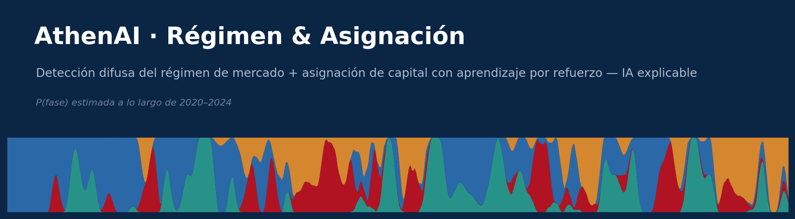
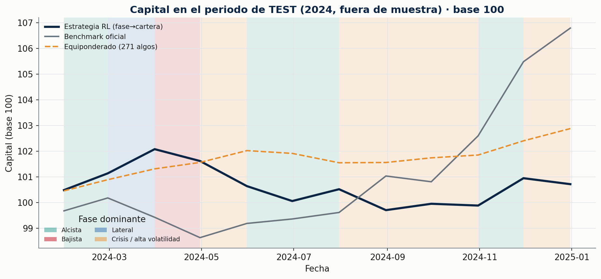
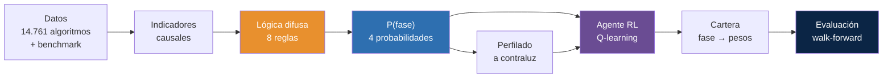
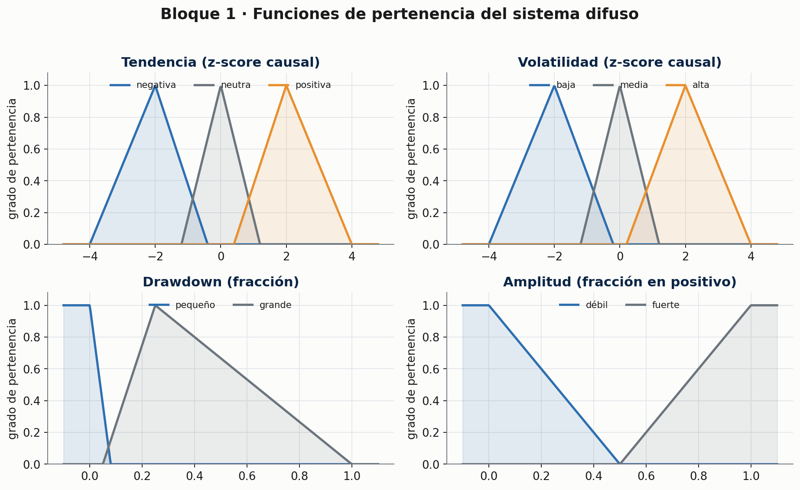
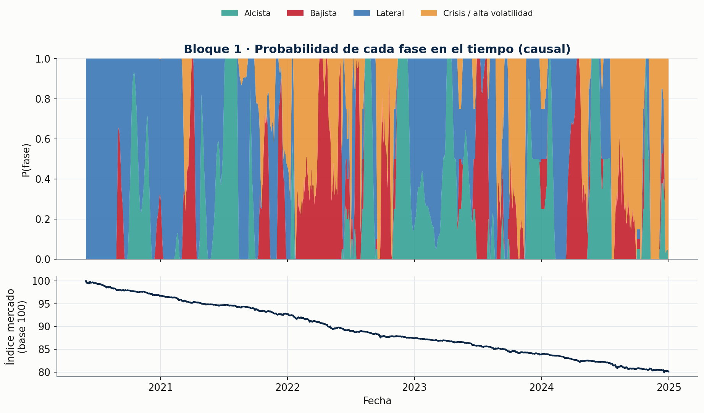
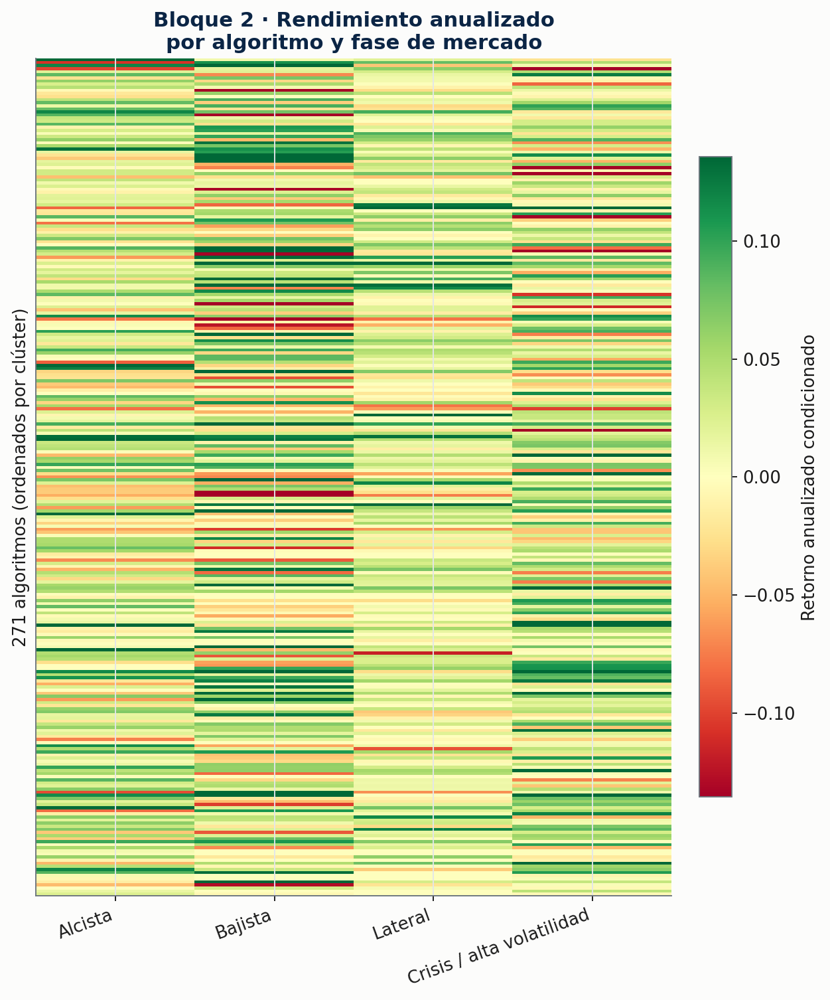
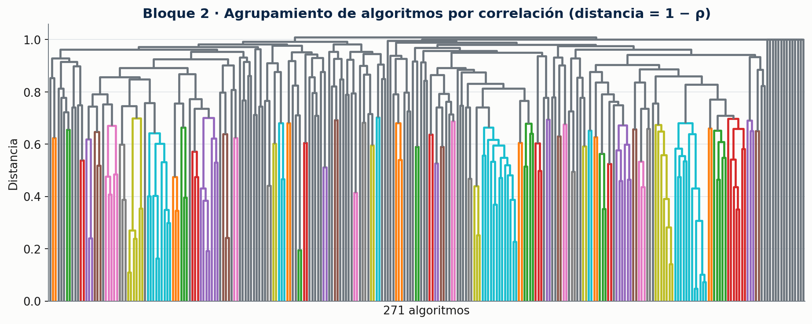
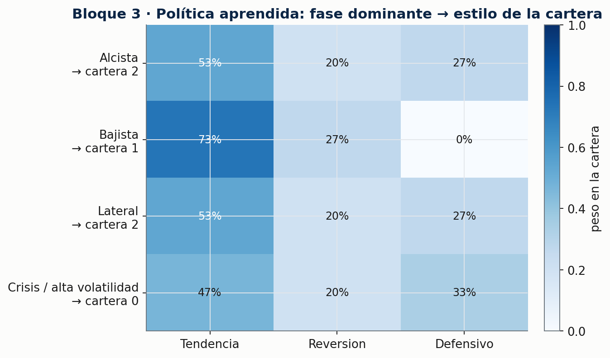
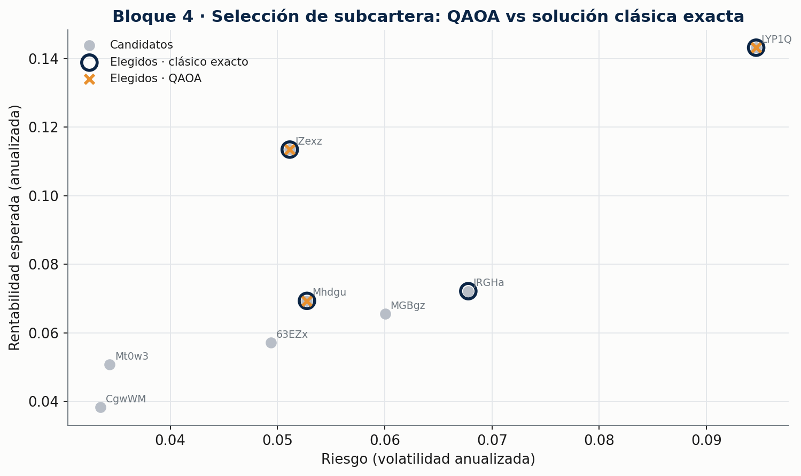

<!-- Banner generado con matplotlib (sin IA generativa). Regenerar: make figures -->



> **TL;DR** — Estima con **lógica difusa** la probabilidad de que el mercado esté en cada una
> de 4 fases (alcista, bajista, lateral, crisis) de forma **causal y explicable**, perfila "a
> contraluz" a <!--AUTO:invested-->271<!--/AUTO:invested--> algoritmos de inversión anónimos y
> usa **aprendizaje por refuerzo** para decidir cómo repartir el capital entre ellos. Cada
> decisión es auditable: se puede leer la regla que la produjo.

---

## 📈 Resultado principal (periodo de TEST, fuera de muestra)



<!--AUTO:test_table-->| Estrategia | CAGR | Vol. | Sharpe | Sortino | Max DD | Calmar | % meses + | Turnover |
|---|---|---|---|---|---|---|---|---|
| **Estrategia RL (fase→cartera)** | 0.7% | 2.4% | 0.31 | 0.63 | -2.3% | 0.31 | 50.0% | 0.42 |
| Benchmark oficial | 6.8% | 3.8% | 1.77 | 6.56 | -1.5% | 4.40 | 66.7% | — |
| Equiponderado (271) | 2.9% | 1.0% | 2.95 | 4.62 | -0.5% | 6.20 | 83.3% | 0.00 |
| Regla difusa sin RL | -5.7% | 3.5% | -1.64 | -2.75 | -5.4% | -1.06 | 25.0% | 0.49 |
| Mejor algoritmo (train) | 15.2% | 12.0% | 1.24 | 0.91 | -6.9% | 2.20 | 66.7% | 0.00 |<!--/AUTO:test_table-->

> **¿La estrategia RL bate al benchmark fuera de muestra?** <!--AUTO:rl_verdict-->**no** (resultado honesto, analizado en Limitaciones)<!--/AUTO:rl_verdict-->.
> Este proyecto prioriza el **rigor y la honestidad** sobre un número bonito: el periodo de test
> (<!--AUTO:test_period-->2023→2024<!--/AUTO:test_period-->) nunca se usa para entrenar ni ajustar,
> y el resultado se reporta tal cual. El análisis de *por qué* está en
> [Limitaciones](#-limitaciones-y-próximos-pasos) y en [`docs/metodologia.md`](docs/metodologia.md).

---

## 🧭 Cómo funciona



El sistema es **estrictamente causal**: cada probabilidad y cada decisión en el instante `t`
usa solo información disponible hasta `t`. Hay tests automáticos que lo verifican.

---

## 🔍 Los datos (verificado por el pipeline)

- **<!--AUTO:universe-->14.761<!--/AUTO:universe-->** curvas de algoritmos de inversión anónimos
  (velas de 4h, base ~100), de los que el benchmark invierte en **<!--AUTO:invested-->271<!--/AUTO:invested-->**.
- Periodo: **<!--AUTO:period-->2020-06-01 → 2024-12-31<!--/AUTO:period-->**.
- **<!--AUTO:flat-->24.3<!--/AUTO:flat-->%** de las series están completamente planas (nunca operan)
  y de media un **<!--AUTO:out_of_market-->33.5<!--/AUTO:out_of_market-->%** del tiempo los algoritmos
  activos están fuera de mercado.
- El universo equiponderado **pierde un <!--AUTO:market_return-->-19.9<!--/AUTO:market_return-->%**
  en el periodo: el mérito del benchmark está en la **selección**, no en el mercado medio.

Detalle completo en [`docs/hallazgos_datos.md`](docs/hallazgos_datos.md).

---

## 🟦 Bloque 1 · Detección difusa de la fase de mercado

Indicadores interpretables (tendencia, volatilidad, drawdown, amplitud) alimentan un sistema de
**<!--AUTO:n_rules-->8<!--/AUTO:n_rules--> reglas difusas en lenguaje natural** que produce 4
probabilidades que suman 1 en cada vela.



> *Ejemplo de reglas:* «**SI** la tendencia es positiva **Y** la volatilidad es baja **ENTONCES**
> alcista» · «**SI** la volatilidad es alta **Y** el drawdown es grande **ENTONCES** crisis».



Distribución de fases: <!--AUTO:regime_dist-->Alcista 24.2% · Bajista 13.6% · Lateral 38.4% · Crisis 23.9%<!--/AUTO:regime_dist-->.
Comparado con un clasificador por **umbrales** sobre los mismos indicadores, ambos coinciden en
el **<!--AUTO:agreement_threshold-->64.2<!--/AUTO:agreement_threshold-->%** de las observaciones.

---

## 🟩 Bloque 2 · Perfilado "a contraluz" de cada algoritmo

A partir solo de su serie se infiere actividad, rentabilidad/riesgo, **rendimiento condicionado a
cada fase**, correlaciones, agrupamiento y una **etiqueta de estilo** (seguidor de tendencia,
reversión a la media, defensivo) con la evidencia que la justifica.




---

## 🟪 Bloque 3 · Asignación de capital con aprendizaje por refuerzo

Un agente **Q-learning tabular** aprende una política legible *fase dominante → cartera*. La
acción no es un vector continuo de pesos sino la elección de una de 4 carteras predefinidas (una
por fase, construidas con datos **solo de entrenamiento**), para que la decisión sea auditable.



**Política aprendida:** <!--AUTO:policy-->Alcista→lateral · Bajista→bajista · Lateral→lateral · Crisis→alcista<!--/AUTO:policy-->

Validación walk-forward (train → validación → test). Resultados en **validación**:

<!--AUTO:val_table-->| Estrategia | CAGR | Vol. | Sharpe | Sortino | Max DD | Calmar | % meses + | Turnover |
|---|---|---|---|---|---|---|---|---|
| **Estrategia RL (fase→cartera)** | 3.4% | 2.3% | 1.46 | 2.91 | -0.8% | 4.18 | 58.3% | 0.22 |
| Benchmark oficial | 2.6% | 3.5% | 0.76 | 1.20 | -1.9% | 1.39 | 66.7% | — |
| Equiponderado (271) | 4.5% | 1.4% | 3.08 | 29.85 | -0.1% | 35.77 | 83.3% | 0.00 |
| Regla difusa sin RL | 1.1% | 2.0% | 0.56 | 0.92 | -0.9% | 1.17 | 58.3% | 0.50 |
| Mejor algoritmo (train) | 8.0% | 6.8% | 1.16 | 1.58 | -3.0% | 2.67 | 66.7% | 0.00 |<!--/AUTO:val_table-->

**Rentabilidad anual por estrategia:**

<!--AUTO:yearly_table-->| Estrategia | 2020 | 2021 | 2022 | 2023 | 2024 |
|---|---|---|---|---|---|
| Estrategia RL | 5.2% | 13.0% | 18.0% | 3.4% | 0.7% |
| Benchmark | 0.9% | 4.8% | 6.1% | 2.6% | 6.8% |
| Equiponderado | 0.2% | 3.2% | 3.6% | 4.5% | 2.9% |<!--/AUTO:yearly_table-->

> ⚠️ **Lectura honesta de la tabla anual:** **2020–2022 son *in-sample* (entrenamiento)**, por lo
> que los buenos números del RL en esos años **no son mérito real**; **2023 es validación** y
> **2024 es test**. La señal que importa es la de 2024, donde el RL (0,7%) queda claramente por
> debajo del benchmark (6,8%). Es el patrón típico del **sobreajuste** y se reporta sin maquillar.

---

## 🧪 Bloque 4 · Experimento cuántico (opcional)

Selección de un subconjunto de algoritmos como problema **QUBO** (rentabilidad esperada vs
riesgo/correlación) resuelto con **QAOA** (Qiskit, simulador) y comparado con la solución clásica
exacta. Es un experimento ilustrativo, explicado para quien no sabe computación cuántica, sin
pretensión de ventaja cuántica.



<!--AUTO:quantum_summary-->Sobre 8 algoritmos candidatos, la solución clásica exacta selecciona **IZexz, LYP1Q, Mhdgu, JRGHa**; QAOA recupera 3 de los 4 activos óptimos. Experimento en simulador, sin ventaja cuántica.<!--/AUTO:quantum_summary--> Ver
[`docs/metodologia.md`](docs/metodologia.md).

---

## ✅ Por qué es explicable (y auditable)

- **Lógica difusa legible**: funciones de pertenencia dibujadas y reglas en lenguaje natural.
  Cualquier P(fase) se puede descomponer en las reglas que la produjeron.
- **Política de RL tabular**: una tabla de 4×4. La decisión de cada mes es una regla
  «fase → cartera» que se puede leer.
- **Carteras transparentes**: cada cartera es una lista de algoritmos equiponderados elegidos
  por criterios explícitos sobre el periodo de entrenamiento.
- **IA no generativa**: nada de LLMs ni modelos de caja negra. Solo indicadores, reglas y una
  tabla Q.
- **Sin lookahead, con tests**: la causalidad se comprueba automáticamente en `tests/`.

---

## ⚙️ Ejecución en 3 comandos

```bash
make setup        # instala el paquete y las dependencias
make synthetic    # genera datos sintéticos en data/raw (sin datos del organizador)
make all          # build + pipeline + figuras + cifras del README
```

Con los datos reales del concurso, coloca `algoritmos/`, `trades_benchmark.csv` y los returns
del benchmark en `data/raw/` (ver [`data/README.md`](data/README.md)) y ejecuta `make all`.

---

## 🗂️ Estructura del repositorio

```
athenai-regime-allocation/
├── configs/default.yaml      # todos los parámetros (sin números mágicos)
├── data/                     # datos NO versionados (+ generador sintético)
├── docs/                     # enunciado, hallazgos, metodología e img/
├── src/athenai/
│   ├── data/                 # carga, limpieza, build, generador sintético
│   ├── regimes/              # indicadores + motor difuso + baselines
│   ├── profiling/            # perfilado de algoritmos
│   ├── allocation/           # entorno RL, agente, baselines
│   ├── quantum/              # experimento QAOA (opcional)
│   ├── evaluation/           # métricas y backtest
│   └── viz/                  # estilo y figuras
├── scripts/                  # build_dataset, run_pipeline, update_readme…
├── tests/                    # causalidad, P(fase)=1, métricas, generador
└── .github/workflows/ci.yml  # ruff + pytest
```

---

## ⚠️ Limitaciones y próximos pasos

- **La estrategia RL no bate al benchmark fuera de muestra.** El benchmark oficial ya incorpora
  una fuerte **habilidad de selección** (invierte en 271 de 14.761 algoritmos); batirlo solo con
  reasignación por régimen es muy difícil. La política RL aprende un comportamiento **defensivo**
  que protege capital (drawdown bajo) pero se pierde parte de las subidas.
- **Muestra pequeña para RL**: ~30 observaciones mensuales de entrenamiento y 4 estados → riesgo
  real de **sobreajuste**. El equiponderado simple sobre los 271 resulta un rival sorprendentemente
  fuerte, lo cual es en sí mismo un hallazgo honesto.
- **Sesgo de supervivencia y series congeladas**: muchos algoritmos nacen tarde o se congelan;
  el universo observado no es neutral.
- **Próximos pasos**: ventanas walk-forward móviles, estados continuos (contextual bandit / PPO),
  selección de cartera dentro de cada fase, y validación con más histórico.

---

## 📝 Créditos y contexto

Proyecto basado en el concurso de algoritmos de inversión de **AthenAI**, en el que participé en
equipo con compañeros del **Grado en Ciencia e Ingeniería de Datos (Universidad de Oviedo)**. El
código del concurso se perdió; esta es una **reimplementación propia y ampliada realizada en 2026**
sobre los mismos datos. No se atribuye a AthenAI ni al equipo nada que no conste en los documentos
del concurso. Los datos del organizador **no se redistribuyen** en este repositorio.

Licencia del código: [MIT](LICENSE).
